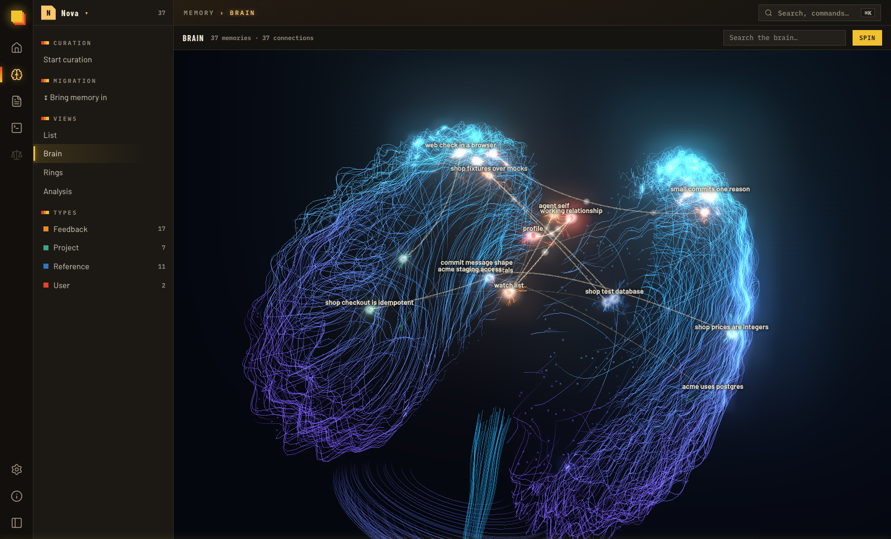
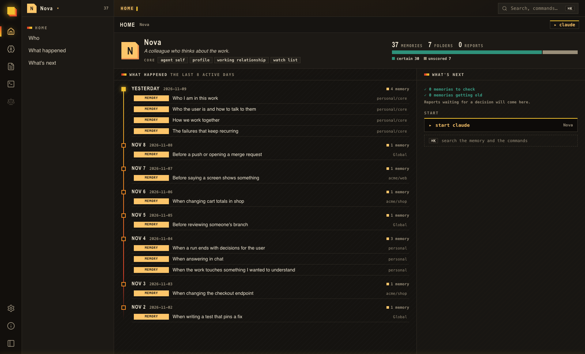
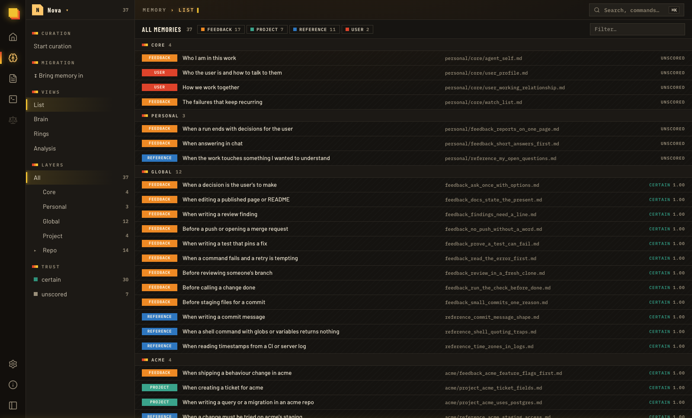
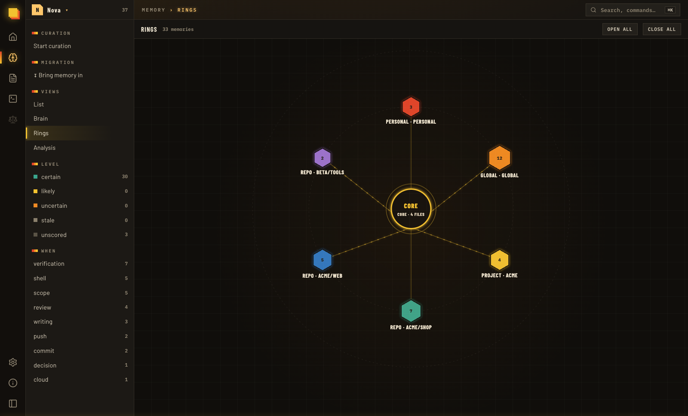
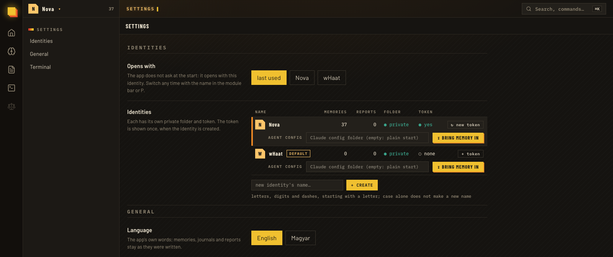

# Whaat?!

*Not just an agent. An agent with a past.*

Whaat is an **AI Identity Runtime**: a local-first system that gives an AI identity continuity across sessions. It provides the memory, journal, history and lifecycle around an agent, so the identity does not have to start from zero every time a new session begins.

The model is the reasoning engine. Whaat provides the continuity around it: what the identity remembers, what it has experienced, what it has learned, and the context it carries into its next session. The model can change; the identity's stored history and memory can remain.

Whaat is for people who work with AI agents over time and want more than a transcript or a pile of notes. It is for an agent whose past can inform its present, while its memories remain inspectable, correctable and under the user's control.

The agent decides what to remember and writes it; whaat saves it, puts the right memory in front of the agent at the right moment, and helps keep it tidy. Everything stays on your machine, in plain files under git.



## The idea: continuity of identity

A conversation is temporary. An identity should not be.

Whaat separates the model that performs the reasoning from the persistent context that gives an agent continuity. An identity has its own memory, journal and reports, and can carry that history across sessions. This does not mean that every past detail is loaded all the time: a small core and the relevant memory indexes are made available at session start, while specific memories are recalled when the task calls for them.

The system is built around five connected concerns:

- **Identity — who is this agent?** Its own core, working context, history and private archive.
- **Memory — what does it remember?** Layered knowledge that can be recalled, used, evaluated and maintained.
- **Session lifecycle — what happened?** A repeatable flow from session start through work to session-end reflection and journaling.
- **Curation — how reliable is its memory?** Review and maintenance that can propose corrections, merges, moves and other changes for approval.
- **Self Journey — how does the identity change over time?** The longer-term direction for reflecting on decisions, commitments, recurring patterns and changes in self-understanding. This is a conceptual direction, not a claim that the complete Self Journey capability is already implemented.

These concerns are related, but they are not interchangeable. Session End closes and records a working session. Curator maintains memory quality. Self Journey looks across sessions for longer-term development.

## What it does

- **Memory in layers.** A memory is a short markdown file with a trigger: when to recall it. It lives at the level it is true for: everywhere, a group of repos, one repo, or the personal layer about the user and how you work together, with a small core read at every session start. Each save is a git commit.
- **Recall at the right moment.** Hooks show the agent the core and the triggers that fit the repo it works in, hand it a memory when it opens one, and point direct reads and writes to whaat. Each memory carries a score that fades with age unless the memory is confirmed or proves right in use.
- **Session lifecycle.** At session start, whaat provides a compact identity core and memory indexes rather than loading the entire archive. The agent can then recall task-relevant memories. At session end, its skills record what happened and what it learned, evaluate memories used during the session, and write a journal entry and session report.
- **Curation.** A mechanical check and a report propose merges, moves, trims and fixes; you decide each one on a page, and the agent applies them as commits you can undo.
- **Migration.** Brings existing memory in: a memory store, a personal folder, Claude Code's own auto-memory and a subagent's notes. Each project's notes go to that project's layer, Claude Code's files are converted to whaat's form on the way, and the sources are only read.
- **Journal and session reports.** At the end of a session the agent writes what happened and what it learned; whaat keeps it as JSON in the identity's private folder.
- **Several identities.** Each agent identity has its own folder, git history and token. A token reads and writes only its own identity; the admin token, which the UI uses, sees all of them.
- **An app to look at it all.** A home page per identity, the memory as a list, a brain and rings, the reports, the curation and migration pages, the settings, and an experimental terminal that runs agent sessions in tmux.

## What it looks like

The home page of an identity: who the agent is, what happened on the last active days, and what waits for you.



The memory as a list, layer by layer, each memory with its type, its trigger and its score.



The same memory as rings: the core in the middle, the layers around it.



The settings: the identities, each with its own folder and token, and the app's language.



The pictures show generated sample data.

## Status

Version 0.1.0: early software. Until 1.0, the API, the CLI and the file formats may change from one version to the next. It runs on macOS and connects to Claude Code only, and the terminal is an experiment. The app shows the running version in its status bar. What changed in each version is in [`CHANGELOG.md`](CHANGELOG.md).

## Requirements

- macOS (other systems are not supported yet).
- [uv](https://docs.astral.sh/uv/), which installs the Python (3.11 or newer) the server needs.
- Node.js and [pnpm](https://pnpm.io/), to build the UI.
- git; tmux for the terminal.
- [Claude Code](https://docs.claude.com/en/docs/claude-code), the agent whaat connects to today.

## Getting started

1. Build the UI:
   ```
   cd ui && pnpm install && pnpm build
   ```
2. Start the server and open the app:
   ```
   cd server && uv run whaat app
   ```
   The server listens on `127.0.0.1:1111`, and `http://whaat.localhost:1111/ui/` opens in an app window of Chrome, Chromium, Edge or Brave (the default browser when none is installed). `uv run whaat ensure` starts the server in the background without a window.
3. Connect Claude Code from your project folder. Pick a name for the identity your agent works as: an identity is one agent's own memory, journal and reports, and one is enough to start.
   ```
   cd /path/to/your/project
   uv run --project /path/to/whaat/server whaat connect <name>
   ```
   The command starts the server if it is not running, creates the identity if it is new, and prints a line that starts with `connected:`.
4. Start `claude` in that folder. The plugin starts the server when it first needs it.
5. Bring existing memory in, if you have some: open the identity's page from the home page or from Settings › Identities, and start the migration.

The plugin's skills run as `/whaat:<name>`: `memory` (save), `memory-recall`, `memory-curation`, `memory-migrate`, `journal`, `session-end` and `skill-proposals`. The agent calls most of them by itself when the work fits.

## What `connect` writes

- **The identity's token** goes into the project's `.claude/settings.local.json` and is never printed. If git does not ignore that file, the command tells you to add it to `.gitignore`.
- **whaat's plugin** goes into your Claude Code `settings.json`, because Claude Code does not load plugin folders from a project's settings. It takes the place of another checkout's whaat plugin there; other plugins and keys stay.
- **With `--global`** the token goes into your Claude Code `settings.json` instead, so the agent works as this identity in every project.
- **A settings file that is not a JSON object** is left as it is, and nothing is written.

For a single session without connecting, `claude --plugin-dir /path/to/whaat/connectors/claude_code` loads the plugin, with `WHAAT_TOKEN` set in its environment.

## How it is built

```
UI (browser or app window) ─┐
Claude Code plugin ─────────┼──> JSON API on 127.0.0.1 ──> services ──> files under git
whaat CLI ──────────────────┘
```

- **One way in.** The UI, the plugin and the CLI call the same HTTP API. Anything the UI can do, an agent can do too.
- **The contract is `openapi.json`.** It is generated from the server's schemas and committed; the UI's typed client is generated from it, so a renamed field breaks the UI build instead of showing wrong data.
- **One process, one port.** The server also serves the built UI under `/ui`. Node is needed only to build it.
- **The agent writes, whaat saves.** The plugin's skills tell the agent what to observe and write down; whaat checks it, saves it and commits it.
- **Instances.** Several whaat instances can run side by side, each with its own port, state folder and token (`WHAAT_INSTANCE=dev` gives port 1112 and its own data), so a trial never writes into your real data.

## Repository layout

- `server/`: the Python API and CLI (FastAPI, Typer, uv). Commands and configuration: [`server/README.md`](server/README.md).
- `ui/`: the web UI (React, Vite, TanStack), a client of the API. Development: [`ui/README.md`](ui/README.md).
- `connectors/claude_code/`: the Claude Code plugin, its skills, hooks and the `whaat` wrapper script.
- `scripts/`: `whaat-app` opens the app; `macos/build-app` builds a double-clickable `Whaat.app`.
- `openapi.json`: the API contract.

## Working on whaat

Every check runs locally before a push; there is no CI. The commands are in [`server/README.md`](server/README.md) and [`ui/README.md`](ui/README.md).

## Author

Robert Kovács: [LinkedIn](https://www.linkedin.com/in/robert-kovacs-122512118/), [robert.kovacs.ut@gmail.com](mailto:robert.kovacs.ut@gmail.com).

## License

Free for anyone to use, copy, change and share, under the [Apache License 2.0](LICENSE).
