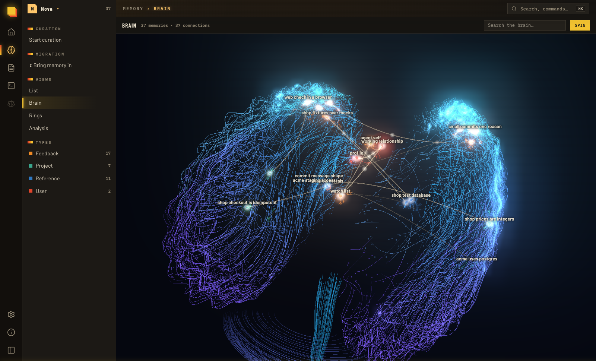
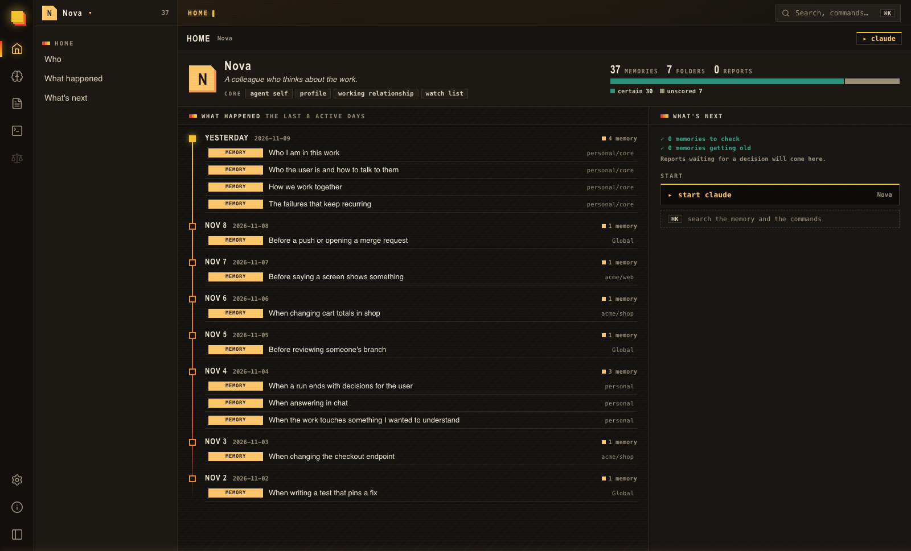
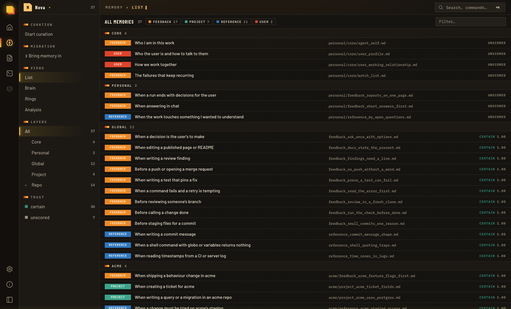
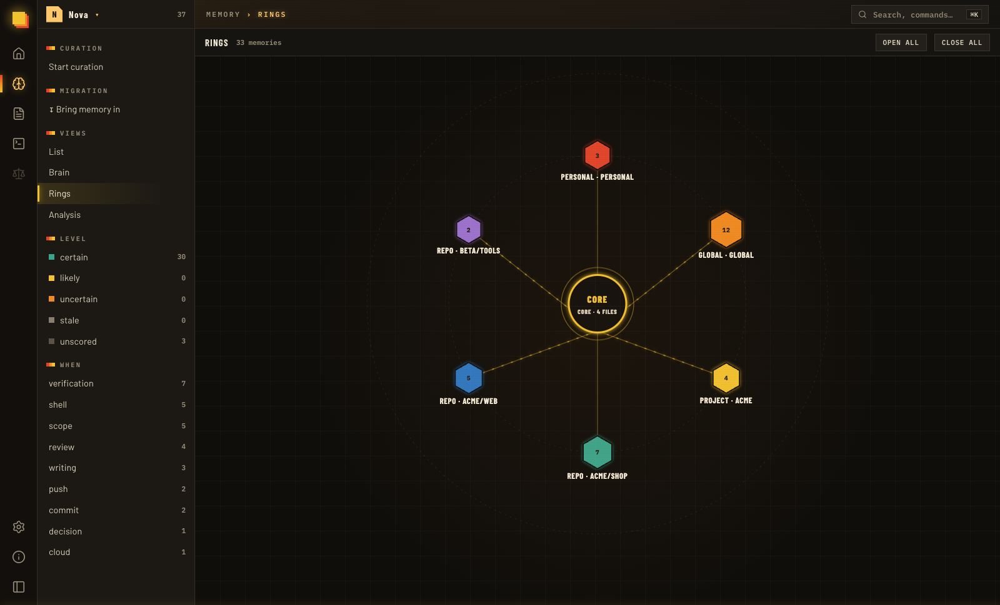
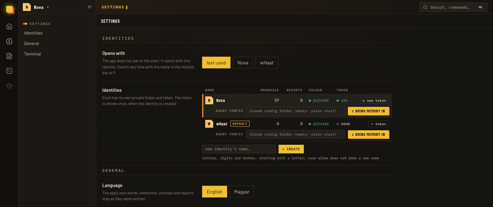

# Whaat?!

*Not just an agent. An agent with a past.*

Whaat is an **AI Identity Runtime**: a local-first system that gives AI agents persistent memory and identity continuity across sessions. It keeps an agent's memory, journal, history and session lifecycle on your own machine, so the identity does not start from zero every time a new session begins. Whaat is for everyone who works with AI agents over time, developers included: anyone who wants more than a transcript or a pile of notes, and an agent whose past can inform its present while its memories stay inspectable, correctable and under their control. It runs on macOS, connects to Claude Code through a plugin and to any MCP (Model Context Protocol) client through its MCP server, and keeps every memory as a plain markdown file in a local Git repository.

For example: on Monday you correct how your agent runs the tests. On Friday, in a new session, the agent recalls that correction as soon as the task touches the tests, and you can open the markdown file where it is kept and see when it was written and changed.

The model is the reasoning engine. Whaat provides the continuity around it: what the identity remembers, what it has experienced, what it has learned, and the context it carries into its next session. The model can change; the identity's stored history and memory can remain.

The agent decides what to remember and writes it; Whaat saves it, puts the right memory in front of the agent at the right moment, and helps keep it tidy. Everything stays on your machine, in plain files. Whaat initializes a local Git repository for the memory store by default, and every save or change is recorded as a commit. The memory therefore has a complete, inspectable change history that can be reviewed and rolled back.



## Quick facts

| | |
|---|---|
| Category | AI Identity Runtime: persistent AI memory and identity continuity for AI agents |
| Version | 0.3.1, early software: the API, the CLI and the file formats may change before 1.0 |
| Platform | macOS; other systems are not supported yet |
| Integrations | Claude Code (plugin with skills and hooks); any MCP client that runs servers over stdio |
| Storage | Local and file-based: markdown memories and JSON reports, one Git repository per identity |
| Interfaces | An app (in a browser or its own window), the `whaat` command line, a JSON API on 127.0.0.1, an MCP server |
| Built with | Python (FastAPI, Typer, the MCP Python SDK, uv); a React UI (Vite, TanStack) |
| License | Business Source License 1.1 (source-available) from 0.2.0; 0.1.0 remains under Apache License 2.0 |

## Identity continuity: why an agent needs a past

A conversation is temporary. An identity should not be.

Whaat separates the model that performs the reasoning from the persistent context that gives an agent continuity. An identity has its own memory, journal and reports, and can carry that history across sessions. This does not mean that every past detail is loaded all the time: a small core and the relevant memory indexes are made available at session start, while specific memories are recalled when the task calls for them.

The system is built around five connected concerns:

- **Identity — who is this agent?** Its own core, working context, history and private archive.
- **Memory — what does it remember?** Layered knowledge that can be recalled, used, evaluated and maintained.
- **Session lifecycle — what happened?** A repeatable flow from session start through work to session-end reflection and journaling.
- **Curation — how reliable is its memory?** Review and maintenance that can propose corrections, merges, moves and other changes for approval.
- **Self Journey — how does the identity change over time?** The longer-term direction for reflecting on decisions, commitments, recurring patterns and changes in self-understanding. This is a conceptual direction, not a claim that the complete Self Journey capability is already implemented.

These concerns are related, but they are not interchangeable. Session end closes and records a working session. Curation maintains memory quality. Self Journey looks across sessions for longer-term development.

## Core capabilities

Each capability has its own page under [`docs/`](docs/README.md).

- **Memory in layers.** A memory is a short markdown file with a trigger: when to recall it. It lives at the level it is true for: everywhere, a group of repos, one repo, or the personal layer about the user and how you work together, with a small core read at every session start. Whaat creates a local Git repository for the memory store by default; every save and subsequent change becomes its own commit, preserving the memory's history. [Memory](docs/memory.md)
- **Recall at the right moment.** Hooks show the agent the core and the triggers that fit the repo it works in, hand it a memory when it opens one, and point direct reads and writes to Whaat. Each memory outside the personal layer carries a score that fades with age unless the memory is confirmed or proves right in use. [Memory](docs/memory.md), [Claude Code plugin](docs/claude-code-plugin.md)
- **Session lifecycle.** At session start, Whaat provides the compact core and memory indexes rather than loading the entire archive. The agent can then recall task-relevant memories. At session end, its skills record what happened and what it learned, evaluate memories used during the session, and write a journal entry and session report. [Journal and session end](docs/journal.md)
- **Curation.** A mechanical check and a report propose merges, moves, trims and fixes; you decide each one on a page, and the agent applies them as commits you can undo. [Curation](docs/curation.md)
- **Migration.** Brings existing memory in: a memory store, a personal folder, Claude Code's own auto-memory and a subagent's notes. Each project's notes go to that project's layer, Claude Code's files are converted to Whaat's form on the way, and the sources are only read. [Migration](docs/migration.md)
- **Journal and session reports.** At the end of a session the agent writes what happened and what it learned; Whaat keeps it as JSON in the identity's private folder. [Journal and session end](docs/journal.md), [Reports](docs/reports.md)
- **Any MCP client.** `whaat mcp` serves the same memory, journal and report calls over MCP, so an agent outside Claude Code can work as an identity too. [MCP layer](docs/mcp.md)
- **Several identities.** Each agent identity has its own folder, git history and token. A token reads and writes only its own identity; the admin token, which the UI uses, sees all of them. [Identities](docs/identities.md)
- **An app to look at it all.** A home page per identity, the memory as a list, a brain and rings, the reports, the curation and migration pages, the settings, and an experimental terminal that runs agent sessions in tmux. [The app](docs/app.md), [Terminal](docs/terminal.md)

Every command is listed on one page: [Command line](docs/cli.md).

## Under the hood: what makes Whaat different

Most memory systems focus on retrieval: store information, find relevant notes, and put them into a model's context. But retrieving a memory does not make it true, current, or safe to rely on.

Whaat treats memory as an **inspectable, versioned and self-correcting knowledge lifecycle**. A memory is more than a piece of text: it has a source, a validity score, an outcome history and a place in an identity's evolving knowledge.

- **Epistemic scoring (`Truthness & Validity`).** Whaat distinguishes where a memory came from from whether it is still valid. `Truthness` captures its source and subsequent outcomes (`held`, `misled`, `irrelevant`); `Validity` tracks its level, score and age. The validity score decays by 0.2 per 120 days, with confirmation and successful use feeding back into its lifecycle. Personal memories, the core included, are not scored and do not decay.

- **Enforced recall, not passive retrieval (`Recall & Write Guards`).** An agent should not have to remember to remember. Whaat's Claude Code hooks route memory access through the runtime: a direct read of a memory file is turned into a logged recall with a stated reason, an opened memory is put into the session's context, and writes into other memory folders are pointed back to Whaat's validated storage. Every hook is listed in [docs/claude-code-plugin.md](docs/claude-code-plugin.md).

- **Memory carries its own warnings.** Recalled memories include their Truthness and Validity information, including source, score and age. The agent is instructed to treat stale or uncertain information cautiously, regard weakly supported memories as assumptions rather than rules, and never apply historical records as current facts without checking.

- **Evidence-driven, human-controlled curation.** Memory maintenance is not simply an LLM being asked to clean up notes. Whaat builds structured curation reports with candidate actions, reasons and evidence. Mechanical checks help constrain proposed changes; the user reviews the actions, and accepted changes are applied through Whaat's versioned storage workflow.

- **Inspectable history, not a black box.** Memories are human-readable files in an identity-specific store. Whaat records saves and subsequent changes as Git commits, so the evolution of an identity's knowledge can be inspected, reviewed and rolled back.

| Capability | Raw `CLAUDE.md` / Auto-memory | Vector-based RAG memory (retrieval-augmented generation) | **Whaat** |
| :--- | :--- | :--- | :--- |
| Human-readable memory | Yes | Often indirect | **Yes** |
| Versioned memory history | Manual / external | Implementation-dependent | **Automatic Git commits** |
| Source and confidence awareness | Limited | Implementation-dependent | **Truthness & Validity** |
| Time-based validity and outcome feedback | No built-in lifecycle | Implementation-dependent | **Scored validity with outcome feedback** |
| Guided memory recall | Agent-dependent | Usually retrieval-driven | **Recall hooks and explicit access logging** |
| Session-aware memory lifecycle | Manual / custom | Implementation-dependent | **Session hooks, framing and outcomes** |
| Human-reviewed maintenance | Manual editing | Implementation-dependent | **Structured curation and approval** |

Whaat does not just give an agent access to its past. It gives that past structure, provenance, feedback and a history that can be inspected and corrected.

## Measured, not only claimed

We measured these on version 0.3.0 in November 2026, on our own working memory and on throwaway test identities. The samples are small: read them as evidence, not as benchmarks.

### Our own memory in daily use (since late September 2026)

| Measure | Result |
|---|---|
| Memories in the store | 593 |
| Changes, each one a commit | 513 added, 859 changed, 37 deleted |
| Recalls | 596 recalls of 214 different memories, in 64 sessions |
| Recalled memories that held (relied on and right) | 88% of 1,530 judgements on 317 memories |
| Irrelevant to the task | 11% |
| Misled | 2% |
| Memories that misled at least once | 25: curation checks that each was fixed |
| Memories irrelevant two or more times | 29: curation proposes a better trigger for each |

The agent itself records whether a recalled memory held, was irrelevant or misled, at the end of each task. The shares stayed the same after the store moved into Whaat.

### Behaviour and speed

| Measure | Result | How |
|---|---|---|
| Trust warnings | Named a stale memory's age: 100% with the trust lines, 0% without. With a weakly backed memory, based the decision on evidence in the repository: 80% with, 0% without; without the lines it followed the memory as a rule every time | Headless agent runs on fresh copies, the current build against one without the trust lines; 5 runs per case and build |
| Parallel saves | 112 of 112 committed, no warning, clean repository | 28 memory and journal saves sent to one identity at the same moment, four rounds |
| Recall index | about 4 ms | Server side, on our store of 593 memories (2.6 MB) |
| Memory graph | about 120 ms | Same store |
| Report list | about 21 ms | 198 reports |
| One hook call | about 0.05 s | Python start-up and the call to the running server |

## What it looks like

The home page of an identity: who the agent is, what happened on the last active days, and what waits for you.



The memory as a list, layer by layer, each memory with its type, its trigger and its score.



The same memory as rings: the core in the middle, the layers around it.



The settings: the identities, each with its own folder and token, and the app's language.



The pictures show generated sample data.

## Status: what works, what is experimental

Version 0.3.1: early software. Until 1.0, the API, the CLI and the file formats may change from one version to the next. The app shows the running version in its status bar. What changed in each version is in [`CHANGELOG.md`](CHANGELOG.md).

- **Works today:** layered memory with recall and scoring, saving through the agent, curation, migration, the journal and session reports, several identities, the Claude Code plugin, the MCP layer and the app.
- **Experimental:** the terminal, which runs agent sessions inside the app.
- **Concept only:** Self Journey.
- **Platform:** macOS only.

## Requirements

- macOS (other systems are not supported yet).
- [uv](https://docs.astral.sh/uv/), which installs the Python (3.11 or newer) the server needs.
- Node.js and [pnpm](https://pnpm.io/), to build the UI.
- git; tmux for the terminal.
- [Claude Code](https://docs.claude.com/en/docs/claude-code) for the plugin, or any client that runs MCP servers over stdio for the MCP layer.

## Getting started

1. Build the UI:
   ```
   cd ui && pnpm install && pnpm build
   ```
2. Start the server and open the app:
   ```
   cd server && uv run whaat app
   ```
   The server listens on `127.0.0.1:1111`, and `http://whaat.localhost:1111/ui/` opens in an app window of Chrome, Chromium, Edge or Brave (the default browser when none is installed). `uv run whaat ensure` starts the server in the background without a window.
3. Connect Claude Code from your project folder. Pick a name for the identity your agent works as: an identity is one agent's own memory, journal and reports, and one is enough to start.
   ```
   cd /path/to/your/project
   uv run --project /path/to/whaat/server whaat connect <name>
   ```
   The command starts the server if it is not running, creates the identity if it is new, and prints a line that starts with `connected:`.
4. Start `claude` in that folder. The plugin starts the server when it first needs it.
5. Bring existing memory in, if you have some: open the identity's page from the home page or from Settings › Identities, and start the migration.

The plugin's skills run as `/whaat:<name>`: `memory` (save), `memory-recall`, `memory-curation`, `memory-migrate`, `journal`, `session-end` and `skill-proposals`. The agent calls most of them by itself when the work fits.

## What `connect` writes

- **The identity's token** goes into the project's `.claude/settings.local.json` and is never printed. If git does not ignore that file, the command tells you to add it to `.gitignore`.
- **Whaat's plugin** goes into your Claude Code `settings.json`, because Claude Code does not load plugin folders from a project's settings. It takes the place of another checkout's Whaat plugin there; other plugins and keys stay.
- **With `--global`** the token goes into your Claude Code `settings.json` instead, so the agent works as this identity in every project.
- **Whaat's recall rule** goes at the top of the same config's `CLAUDE.md`, between `<memory_handling>` tags, because a plugin cannot bring a `CLAUDE.md` and an agent only recalls on its own when one asks it to. Every project of that config reads it; connecting again replaces only whaat's block.
- **A settings file that is not a JSON object**, or a `CLAUDE.md` that cannot be read or written, is left as it is, and nothing is written.

After updating Whaat, restart its server (the ↻ button in the UI) and start the open Claude Code sessions again, or run `/reload-plugins` in them: a server keeps the code it started with, and a session keeps the hooks it loaded at its start.

For a single session without connecting, `claude --plugin-dir /path/to/whaat/connectors/claude_code` loads the plugin, with `WHAAT_TOKEN` set in its environment.

## Try it next to your current setup

If you already run Claude Code with your own memory skills, hooks or `CLAUDE.md` rules, connect Whaat to a separate Claude Code config instead of your regular one. Both then work in the same project folder: `claude` starts your usual setup, and the separate config starts an agent that works through Whaat.

Claude Code takes its settings, skills, agents, hooks and session history from the folder in `CLAUDE_CONFIG_DIR` (`~/.claude` when it is not set). Whaat does not create that folder for you yet, so you choose what goes into it.

1. Create the folder and copy in what you want to keep from your regular config, for example `skills/` and `agents/`. Leave out your own memory skills and memory hooks: Whaat's plugin provides recall, saving and the session end.
   ```
   mkdir -p ~/.claude-whaat
   ```
2. Connect it from your project folder, with `--global`:
   ```
   cd /path/to/your/project
   CLAUDE_CONFIG_DIR=~/.claude-whaat uv run --project /path/to/whaat/server whaat connect <name> --global
   ```
   The token and the plugin go into `~/.claude-whaat/settings.json`, and your regular `settings.json` is not touched. Without `--global` the token would go into the project's `.claude/settings.local.json`, which your regular setup reads too.
3. Start Claude Code with that config, in the same project folder:
   ```
   CLAUDE_CONFIG_DIR=~/.claude-whaat claude
   ```
   The first start asks you to log in, because the login does not carry over from your regular config. The variable applies to this one start only: plain `claude` still opens your usual setup, and the two can run at the same time.
4. Bring your existing memory in with the migration (step 5 of Getting started). It only reads the sources, so your regular setup keeps working as before.

If your project lives inside your home folder, Claude Code can also load `~/.claude/CLAUDE.md` as a file of a parent folder. To keep its memory rules out of the Whaat sessions, add the file's full path to `claudeMdExcludes` in `~/.claude-whaat/settings.json`:
```json
"claudeMdExcludes": ["/Users/<you>/.claude/CLAUDE.md"]
```

## MCP layer

`whaat mcp` is an MCP server over stdio. It serves the calls the Claude Code skills make, with the same inputs, and nothing more, as the identity whose token it gets. Every tool is listed in [docs/mcp.md](docs/mcp.md).

1. Create an identity, or use one you have. A new one prints its token once:
   ```
   uv run --project /path/to/whaat/server whaat identity add <name>
   ```
2. Add it as a stdio server to an MCP configuration:
   ```json
   {
     "mcpServers": {
       "whaat": {
         "command": "/path/to/whaat/connectors/claude_code/scripts/whaat",
         "args": ["mcp"],
         "env": { "WHAAT_TOKEN": "<the identity's token>" }
       }
     }
   }
   ```
   Keep that file readable only by you: the token writes in the identity's name.
3. Start the client. `whaat mcp` starts the Whaat server if it is not running. A server that already runs keeps its version: after updating Whaat, restart it, or the new calls are refused.

What the agent gets:
- **One identity, chosen by the token.** The admin token names no identity, so the memory and journal calls refuse it.
- **The identity's core at the start.** The server's instructions carry an outline of the personal core and ask the agent to call `identity_load`, which returns the whole core, before its first reply.
- **Its calls logged under the client's session.** When the client passes `CLAUDE_CODE_SESSION_ID` to its MCP servers, as Claude Code does, recall, outcomes and the journal use that session; otherwise each `whaat mcp` process keeps one of its own.
- **The procedure in words only.** Without the plugin's skills and hooks, nothing enforces recall at the start of a task or the order of a curation run; the instructions and the tool descriptions describe them.

## How it is built

```
UI (browser or app window) ─┐
Claude Code plugin ─────────┤
whaat CLI ──────────────────┼──> JSON API on 127.0.0.1 ──> services ──> files under git
MCP client ──> whaat mcp ───┘
```

- **One way in.** The UI, the plugin, the CLI and the MCP layer call the same HTTP API. The UI has no back door of its own.
- **The contract is `openapi.json`.** It is generated from the server's schemas and committed; the UI's typed client is generated from it, so a renamed field breaks the UI build instead of showing wrong data.
- **One process, one port.** The server also serves the built UI under `/ui`. Node is needed only to build it.
- **The agent writes, Whaat saves.** The plugin's skills tell the agent what to observe and write down; Whaat checks it, saves it and commits it.
- **Instances.** Several Whaat instances can run side by side, each with its own port, state folder and token (`WHAAT_INSTANCE=dev` gives port 1112 and its own data), so a trial never writes into your real data.

## Security and privacy

- **Local only.** The server listens on 127.0.0.1, and every memory, journal and report is a file on your machine. The server calls no outside service and never pushes a Git repository. The one outside request is the app loading its fonts from Google Fonts.
- **One token per identity.** An identity's token reads and writes only that identity's folder. The admin token sees every identity but names none, so it cannot write anyone's memory or journal.
- **Tokens stay out of the memory.** The server checks a SHA-256 digest of each token. Tokens are kept in the state folder, never in an identity's Git repository, and `connect` writes them into settings files without printing them.
- **Private files.** Memory files are readable only by you (folders 700, files 600).
- **The app holds the admin token.** The server puts it into the page it serves, so anyone who can open the app on your machine can act as the admin. For a local app this is accepted.
- **The terminal runs commands on your machine.** It needs the admin token and checks that the page opening a session is Whaat's own, because any website in your browser could try to connect to a local port.

## Repository layout

- `server/`: the Python API, the CLI and the MCP layer (FastAPI, Typer, the MCP Python SDK, uv). Commands and configuration: [`server/README.md`](server/README.md).
- `ui/`: the web UI (React, Vite, TanStack), a client of the API. Development: [`ui/README.md`](ui/README.md).
- `connectors/claude_code/`: the Claude Code plugin, its skills, hooks and the `whaat` wrapper script.
- `docs/`: one page per module, in plain words: [`docs/README.md`](docs/README.md).
- `scripts/`: `whaat-app` opens the app; `macos/build-app` builds a double-clickable `Whaat.app`.
- `openapi.json`: the API contract.

## Working on Whaat

Every check runs locally before a push; there is no CI. The commands are in [`server/README.md`](server/README.md) and [`ui/README.md`](ui/README.md).

## Frequently asked questions

### What is an AI Identity Runtime?
A system that keeps the persistent memory, history and context an AI agent needs to stay the same identity across sessions. Whaat is one: it holds the identity's memory, journal and reports, and puts the relevant part in front of the agent when a session starts and when a task calls for it.

### Is Whaat an AI model?
No. Whaat is not a language model and runs no model. It provides the identity, memory and session lifecycle around an AI agent that runs on a model of its own.

### Does it work with different AI models?
Whaat keeps the identity apart from the model: nothing in it depends on which model the agent runs on. It connects to Claude Code through its plugin and to other agents through its MCP server; which models those clients can use depends on the client.

### Does Whaat store data in the cloud?
No. Memories, journals and reports stay on your machine, in plain files and local Git repositories, and the server calls no outside service; the app only loads its fonts from Google Fonts. See [Security and privacy](#security-and-privacy).

### Does it support MCP?
Yes. `whaat mcp` is an MCP (Model Context Protocol) server over stdio that offers the memory, journal and report calls as tools. Without the Claude Code plugin's hooks, recall is not enforced; the tool descriptions explain the steps.

### Does it replace Claude Code's own memory?
For the agent that works through Whaat, yes: a hook declines writes into Claude Code's auto-memory and points the agent to Whaat, and recall goes through Whaat. Your `CLAUDE.md` files keep working, and `connect` adds a short recall rule to the config's `CLAUDE.md`. To keep your current setup untouched, see [Try it next to your current setup](#try-it-next-to-your-current-setup).

### Can I bring my existing memory in?
Yes. The migration reads a memory store, a personal memory folder, Claude Code's auto-memory and a subagent's memory, and imports the groups you choose. It never changes the sources. See [Migration](docs/migration.md).

### Which operating systems are supported?
macOS. Other systems are not supported yet.

### What license does Whaat use?
Version 0.2.0 and later, including 0.3.1, are licensed under the Business Source License 1.1, which makes the code source-available, not open source. Release 0.1.0 remains under the Apache License 2.0. See [License](#license).

## Author

Robert Kovács: [LinkedIn](https://www.linkedin.com/in/robert-kovacs-122512118/), [robert.kovacs.ut@gmail.com](mailto:robert.kovacs.ut@gmail.com).

## License

Licensed under the [Business Source License 1.1 (BUSL-1.1)](LICENSE). Copying, modification, redistribution and non-production use are permitted under its terms. Additional Use Grant: None. The Change Date is 2030-11-14 (or the fourth anniversary of first public distribution of this version, whichever comes first), after which the Change License is GPL-2.0-or-later. The previous 0.1.0 release remains under Apache License 2.0.
